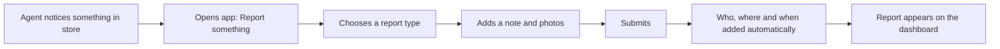
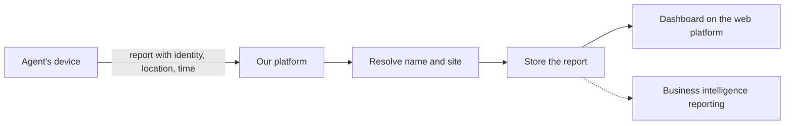

# Proposal: Letting Agents Report What They See, Without Being Asked

Status: concept, for presentation to the design and sponsorship teams.
Technical detail and the working demo are described in [Agent Templates and Work Events Dashboard](./agent-templates-and-dashboard.md).

## In one paragraph

Agents already spot things in store that nobody asked them to look at: a full returns bay, a messy pallet area, a promotion flyer nobody has seen. Today they report these on WhatsApp, where the information is scattered, hard to find and impossible to report on. We propose adding a simple "Report something" option to the Agent's device app. The Agent picks what they are reporting, adds a note and photos, and submits. The report arrives structured, stamped with who, where and when, and is visible straight away on a dashboard.

## The problem

### How work reaches an Agent today
Every piece of work on the device starts with a team leader. A task is created, linked to an appointment and sent down to the Agent. If the team leader wants something done, they have to ask first, and the Agent confirms back. That works for planned work.

### What it misses
A lot of valuable work is not planned. Agents use their own judgement while in a store:

- A pallet bay is messy.
- The returns bay or returns pallet is full.
- They see a flyer or promotion they have not seen before and want someone to know about it.

### How it is handled today
The Agent takes a photo or writes a comment and sends it on WhatsApp. This causes real problems:

- **Hard to find:** information is buried in chat threads.
- **Hard to count:** there is no way to answer "how many full returns bays this week?"
- **Missing context:** a photo does not say which site, who took it, or exactly when.
- **Not owned:** nobody is accountable for acting on it, and nothing is tracked.
- **Outside our systems:** the data never reaches reporting or business intelligence.
- **Back and forth:** where there is a task, it takes several messages to get it done and confirmed.

## How it works for the Agent

1. **Notice.** The Agent is in a store, warehouse or office and sees something worth reporting. Or is asked by a team leader, _"Everyone take a picture of your return bays today."_
2. **Open.** They open the app and tap **Report something**.
3. **Choose.** They pick what they are reporting from a short list (for example "Returns bay").
4. **Capture.** A very simple form appears: a place for a note and a place to take one or more photos. That is all.
5. **Submit.** They tap submit. The app automatically adds who they are, where they are and the time. They do not type any of that.
6. **Done.** The report is sent. The Agent carries on with their visit.

## What happens after the Agent submits

1. The report is sent to our systems with the Agent's identity, location and time.
2. The system works out the Agent's name and which site the location belongs to (a store, warehouse, head office or other), so people see names and sites, not raw coordinates.
3. The report is stored with all other reports.
4. The dashboard on the web platform shows it almost immediately.

The dashboard has two jobs: showing what has been reported today, and letting people look back and compare.

## The report types ("templates")

A template is a named, ready-made form for one kind of report. The Agent just picks a name and the form is already set up. For the demo we suggest:

- **Returns bay:** the returns bay or pallet needs attention.
- **Pallet bay / backroom tidy:** an area is messy.
- **New flyer or promotion spotted:** a flyer or promotion the team may not know about.
- **Stock issue:** out of stock, damaged or expired stock.
- **General observation:** anything else, so that nothing falls back to WhatsApp.

At first every template is the same simple shape: a note and photos (a few add one small extra question, such as how full the returns bay is). Templates can become richer over time.

## What the dashboard shows

Someone viewing the dashboard can:

- Choose a report type and see the answers summarised in charts (for example how full the returns bays are).
- Read the notes and see the photos.
- See who reported, at which site, and when.
- Narrow the view by report type, site, Agent or date range. For example: "every full returns bay at this site, whoever reported it, any date".

A working demo of this exists, using sample data.

## Who benefits

| Who | What they get |
|---|---|
| **Agents** | A quick, simple way to report, with nothing to type about who or where. Their initiative is visible instead of lost in a chat. |
| **Team leaders** | One place to see what is being reported, instead of chasing messages. |
| **Management and reporting** | Reports that can be counted and compared across sites, Agents and time. |
| **The business** | Problems in store are spotted and acted on faster, and the data feeds the same reporting as planned work. |

## What this does not change

- Planned tasks, appointments and the way team leaders assign work stay exactly as they are.
- The existing task types and forms are untouched.
- No new equipment is needed. Devices are company-managed, and location is captured automatically, so no consent step is needed.

## Success measures (suggested)

- Fewer work-related photos and comments sent on WhatsApp.
- The number of reports submitted per week, by site and report type.
- The time between something being spotted and someone seeing it.
- The share of reports with a site resolved and photos attached.
- Agent feedback on how easy it is to use.

## Rollout in phases

1. **Demo (done):** five sample templates, a mobile preview, and a dashboard with sample data. This is what we show.
2. **First pilot:** a small set of templates and a small group of Agents at a few sites, with real reports flowing to the dashboard.
3. **Next:** templates managed by administrators on the web platform and sent to devices, matching sites to customer locations, and richer forms.
4. **Later:** notifications to team leaders, turning a report into a task for follow-up, and acknowledgement of reports.

## Risks and things to watch

- **Volume:** if reports are easy to make, there may be many. The dashboard needs good filtering and (later) a way to prioritise.
- **No follow-up:** a report nobody acts on will discourage Agents. We need to decide who owns what happens next.
- **Photo size and poor signal:** photos are large, and connectivity in store varies. We assume comms are available for now, but this needs a clear answer before a pilot.
- **Too many templates:** a long list is slow to use, so we should keep the list short and sensible.
- **Misuse:** a free-text "general observation" could be used for things it was not meant for. We should review how it is used in the pilot.

## Decisions we need

1. **Who is told?** Should a team leader be told immediately when something is reported, or is the dashboard enough?
2. **Who creates templates?** Developers only for the demo, but should it become an administrator task on the web platform? (We expect yes.)
3. **Where do reports live?** In the task management platform, in business intelligence directly, or both? We lean towards the task management platform, with business intelligence reading from it.
4. **Limits:** how many photos per report, how large, and what should happen with no signal?
5. **Ownership:** who is responsible for acting on a report once it appears?
6. **Link to appointments:** reports are tied to a location, not an appointment. Is that enough?

## Summary

Agents already do valuable work on their own initiative; we just have no good way to capture it. A simple "Report something" option replaces the WhatsApp habit with a structured, reportable record, without changing how planned work runs. We have a working demo and a sensible path from demo to pilot.
