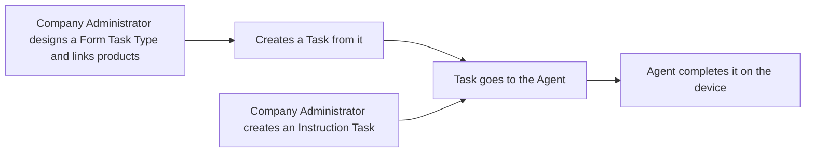

# Form and Instruction Tasks: future state

Status: draft for approval. Several decisions are still open; they are listed at the end.

## Summary

The Task Management app lets a Company Administrator create Task Types and assign Tasks. We propose two new kinds of **Functions**:

- **Form.** The Company Administrator designs a questionnaire once, in a visual designer. Agents complete it in the field.
- **Instruction.** The Company Administrator writes a one-off request ("Check the end-of-aisle display and send a photo") and chooses what the Agent must send back.

A proof of concept (POC) shows both working. This document describes how they would work in the real app. It covers **creating** these Task Types and Tasks only. How the Agent completes them on a device, and reporting on the answers, are handled separately.

## Who is involved

| Who | Role |
|---|---|
| **Company Administrator** | Designs Task Types and Forms, and creates Tasks. |
| **Agent** | The field person who completes the Form or Instruction on a mobile device. |
| **Product Master Data** | The external system that owns the product catalogue and its Tags. |

## How it works

### Task Type screens

Task Types get their own routes and screens:

| Route | Purpose |
|---|---|
| `task-types/new` | Create a Task Type. |
| `task-types/[uuid]` | View and edit an existing Task Type. |

`FORM` is a new **Function** on the Task Type. Choosing it lets the Company Administrator build a customisable Form with SurveyJS.

### Form Task Types

1. The Company Administrator creates a Task Type on `task-types/new` and chooses **Form** as its Function.
2. They design the Form in the SurveyJS Survey Creator. We control which parts of SurveyJS they see, and its theme, so that Forms stay simple and consistent.
3. They can preview the Form on a phone-sized screen, from inside the designer or from the list.
4. The Form is saved with the Task Type and can be reopened and edited on `task-types/[uuid]`.

**What the user sees of SurveyJS**

- Only the **Designer** and **Preview** tabs, with limited control over question properties.
- A fixed theme. The user can't change it.
- Everything else (logic, translations, theme editor, JSON editor) is hidden.

**What the designer offers**

| Kind | Question | Notes |
|---|---|---|
| Basic | Single-line input, Long text, Checkboxes, Radio buttons, Dropdown, Yes/No, Number | Built-in or thin presets. |
| Predefined | Photo | A built-in question with locked settings (images only). |
| Custom | Merchandising Survey, and others to follow | Purpose-built questions, see below. |

Each question can be marked **required**. That is the only rule on an answer. There is no conditional logic (showing or hiding questions) in version 1. Which custom questions ship is still to be agreed with the mobile team.

### Custom questions

A custom question is a ready-made, multi-field question, such as the **Merchandising Survey** (one row per product, with columns for shelf facings, shelf position and second display type). Its columns, row styling and default title are fixed by us.

- Each comes with a **predefined title** (for example "Merchandising Survey - "), used to identify the question when it is the only one on the Form.
- It is undecided how, and at what level, that title is enforced. See open questions.
- It is also undecided whether a Form that contains a custom question may include other questions.

**Rules that stay as they are today**

- A Task Type's name and Function can't change after it is created.
- A Task Type is **Active** or **Inactive**. An Inactive one can't be used for new Tasks, but Tasks that already exist can still be completed.
- Each Form carries a **version number**. It goes up only when the questions change, not when the name or status changes.

### Products in a Form

Only a specific set of questions can be linked to products, not every question. Products are chosen **only when the Task Type is created or edited**, never when a Task is created.

- A Task Type is linked to a fixed set of products the moment its Form is saved.
- To cover new products, a Company Administrator updates the linked products on the Task Type.
- A Task simply uses the products on its Task Type. There is no product step when creating a Task.
- A product-linked question can't be saved without products.

A custom question such as the Merchandising Survey turns the chosen products into rows: the row value is the product's ID and the row text is its description. The rows are visible in the Form, so changing the products means updating the Task Type.

Products are chosen by filtering on **Tags** such as manufacturer, product line, catalogue or variant. Both the Tag names and their values come from Product Master Data, so nothing is hard-coded.

### Instruction Tasks

- There is **one** Instruction Task Type per Company Context (one company's set of Task Types and Tasks). Its name is fixed and it is **immutable**: it has no designer and no Form of its own.
- It is the **exception** to the rule that a Task Type holds all the configuration. Its data is captured **only when a Task is created**, so creating an Instruction Task needs its own interface (instruction text and response types) in the Task creation flow.
- When creating the Task, the Company Administrator writes the instruction as **plain text** and picks one or more responses:

| Response | What the Agent sends back |
|---|---|
| Done | A yes/no answer. |
| Text | A written comment. |
| Photo | One or more photos from the camera or gallery. |

- At least one response must be chosen, and every chosen response is required.
- The Instruction Task Type has **one fixed, versioned Form** containing all three responses (Done, Text, Photo). It does not use a Form designed on the Task Type, and the Task does not carry a generated form.
- The **instruction text is not part of the Form schema**. The schema is shared by every Instruction Task and has one version, while the text differs for each Task. Putting the text in the schema would need a copy of the schema per Task and break versioning. The text is stored on the Task, beside the variables, as `instruction: { text, variables }`. The renderer shows the text above the Form.

### What is saved with a Task

- Which Task Type it came from.
- The Form version it was created against.
- For product questions: nothing extra. The products come from the Task Type.
- For Instructions: the instruction text and the `variables` that switch the responses on or off (`showDone`, `showText`, `showPhoto`). The Form version is the fixed Instruction Form's. A response whose variable is false is hidden and not required.
  - The renderer's only extra step is to call `setVariable` for each entry in `variables`. The fixed Form's `visibleIf` and `requiredIf` conditions do the rest.

Everything else about creating a Task (customer location, occurrence, assignee) is unchanged.

## Decisions already made

- SurveyJS is the form designer (see `docs/adr/0003-surveyjs-is-the-engine.md`).
- The backend stores the Form as JSON it doesn't read, along with the name of the designer used (see `docs/adr/0002-opaque-form-schema-with-engine.md`).
- Submissions are tied to the Form version they were answered on (see `docs/adr/0001-form-versioning.md`).
- Instructions are text only.
- Reporting is out of scope, except that answers are keyed on Task Type plus question name.

- Products are linked at Task Type level only, and only to a specific set of questions.
- The "Take Photo" **Function** (a Task Type Function) and the PDF Function are removed. No new PDF or Take Photo Tasks can be created. The **Photo** question and the Instruction Photo response are unaffected.

## Out of scope

## Open questions

These need discussion before the design is final. More detail is in `docs/open-questions.md`.

| # | Question | Why it matters |
|---|---|---|
| 1 | **Form version history.** How do we keep older versions, and what happens to answers when a later version drops a question type? | Answers from version 1 may not match the latest Form. |
| 2 | **Tasks scheduled for later.** When a Form changes, should a Task that hasn't started move to the new version? | We lean towards yes, but how isn't worked out. Whether a started Task keeps its version is not discussed. |
| 3 | **Sending products to the device.** Do we send every product, or just a product line or Tag references? | A product line can hold hundreds of products. |
| 4 | **Product Master Data API.** What is the endpoint, what comes back, and do Tags and products need separate calls? | Product Master Data stores every product with all its Tags, and clients build the Tag list themselves. |
| 5 | **Photos.** How do photos get from the device to the microservice, and are they stored there? | Affects storage, size limits and offline use. |
| 6 | **Which custom questions ship.** Number, Photo, Merchandising Survey and Shopper Questionnaire need the mobile team's agreement. | We won't offer a question the device can't render. |
| 8 | **Custom question titles.** Custom questions carry a predefined title (e.g. "Merchandising Survey - ") that identifies a single-question Form. How and at what level is this enforced? | Decides whether the title is locked, validated on save, or only a default. |
| 9 | **Mixing custom questions with others.** Can a Form with a custom question also hold other questions? | Affects the designer and how answers are reported. |
| 10 | **Which questions can link to products.** Which question types are product-linked? | Limits the product picker to the right questions. |
| 11 | **Existing PDF and Take Photo Tasks.** What happens to Tasks and Task Types already using these Functions? | They must stay completable, or be migrated. |
| 7 | **Question names.** A random ID or a slug of the question title? | Depends on how the business intelligence system handles the incoming data. |
