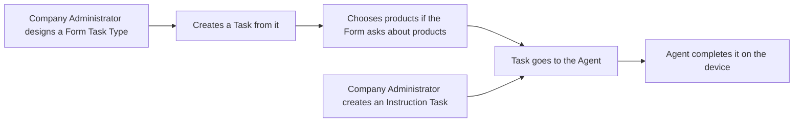

# Form and Instruction Tasks: future state

Status: draft for approval. Several decisions are still open; they are listed at the end.

## Summary

The Task Management app lets a Company Administrator create Task Types and assign Tasks. We propose two new kinds of **Functions**:

- **Form.** The Company Administrator designs a questionnaire once, in a visual designer. Agents complete it in the field.
- **Instruction.** The Company Administrator writes a one-off request ("Check the end-of-aisle display and send a photo") and chooses what the Agent must send back.

A proof of concept (POC) shows both working. This document describes how they would work in the real app. It covers **creating** these Task Types and Tasks only. How the Agent completes them on a device, and reporting on the answers, are handled separately.

## Who is involved

| Who | Role |
|---|---|
| **Company Administrator** | Designs Task Types and Forms, and creates Tasks. |
| **Agent** | The field person who completes the Form or Instruction on a mobile device. |
| **Product Master Data** | The external system that owns the product catalogue and its Tags. |

## How it works

### Form Task Types

1. The Company Administrator creates a Task Type and chooses **Form** as its Function.
2. They design the Form in the SurveyJS Survey Creator. The designer is deliberately limited so that Forms stay simple and consistent.
3. They can preview the Form on a phone-sized screen, from inside the designer or from the list.
4. The Form is saved with the Task Type and can be reopened and edited.

**What the designer offers**

| Question | Notes |
|---|---|
| Single-line input, Long text, Checkboxes, Radio buttons, Dropdown, Yes/No | Built-in. |
| Number, Photo, Product, Price Check | Custom. Which ones ship is still to be agreed with the mobile team. |

Each question can be marked **required**. That is the only rule on an answer. There is no conditional logic (showing or hiding questions) in version 1.

**Rules that stay as they are today**

- A Task Type's name and Function can't change after it is created.
- A Task Type is **Active** or **Inactive**. An Inactive one can't be used for new Tasks, but Tasks that already exist can still be completed.
- Each Form carries a **version number**. It goes up only when the questions change, not when the name or status changes.

### Products in a Form

Some questions are about products. The Company Administrator can:

- set a fixed list of products on the question when designing the Task Type, or
- leave the list empty and choose the products each time a Task is created.

Products fixed on the Task Type are locked when the Task is created. A Task can't be saved while a product question has no products.

A product question works in one of two modes:

| Mode | Meaning |
|---|---|
| One answer for all products | The Agent answers the question once. |
| Repeated for each product | The Agent answers the question separately for every product. |

Products are chosen by filtering on **Tags** such as manufacturer, product line, catalogue or variant. Both the Tag names and their values come from Product Master Data, so nothing is hard-coded.

### Instruction Tasks

- There is **one** Instruction Task Type per Company Context (one company's set of Task Types and Tasks). Its name is fixed.
- When creating the Task, the Company Administrator writes the instruction as **plain text** and picks one or more responses:

| Response | What the Agent sends back |
|---|---|
| Done | A yes/no answer. |
| Text | A written comment. |
| Photo | One or more photos from the camera or gallery. |

- At least one response must be chosen, and every chosen response is required.
- The Task carries its own generated form. It does not use a Form designed on the Task Type.

### What is saved with a Task

- Which Task Type it came from.
- The Form version it was created against.
- For product questions: the mode and the chosen products.
- For Instructions: the instruction text and the form generated from the chosen responses.

Everything else about creating a Task (customer location, occurrence, assignee) is unchanged.

## Decisions already made

- SurveyJS is the form designer (see `docs/adr/0003-surveyjs-is-the-engine.md`).
- The backend stores the Form as JSON it doesn't read, along with the name of the designer used (see `docs/adr/0002-opaque-form-schema-with-engine.md`).
- Submissions are tied to the Form version they were answered on (see `docs/adr/0001-form-versioning.md`).
- Instructions are text only.
- Reporting is out of scope, except that answers are keyed on Task Type plus question name.

## Out of scope

## Open questions

These need discussion before the design is final. More detail is in `docs/open-questions.md`.

| # | Question | Why it matters |
|---|---|---|
| 1 | **Form version history.** How do we keep older versions, and what happens to answers when a later version drops a question type? | Answers from version 1 may not match the latest Form. |
| 2 | **Tasks scheduled for later.** When a Form changes, should a Task that hasn't started move to the new version? | We lean towards yes, but how isn't worked out. Whether a started Task keeps its version is not discussed. |
| 3 | **Sending products to the device.** Do we send every product, or just a product line or Tag references? | A product line can hold hundreds of products. |
| 4 | **Product Master Data API.** What is the endpoint, what comes back, and do Tags and products need separate calls? | Product Master Data stores every product with all its Tags, and clients build the Tag list themselves. |
| 5 | **Photos.** How do photos get from the device to the microservice, and are they stored there? | Affects storage, size limits and offline use. |
| 6 | **Which custom questions ship.** Number, Photo, Product and Price Check need the mobile team's agreement. | We won't offer a question the device can't render. |
| 7 | **Question names.** A random ID or a slug of the question title? | Depends on how the business intelligence system handles the incoming data. |
